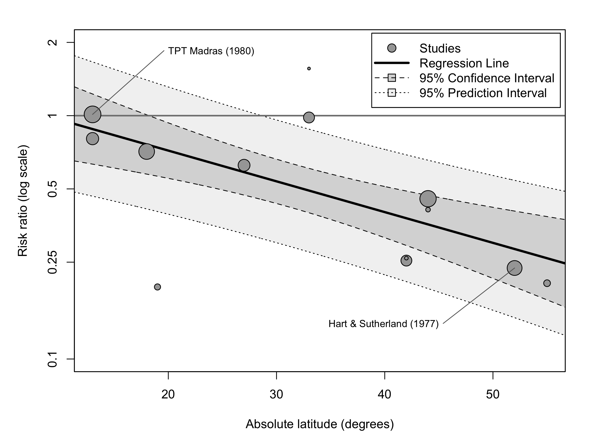
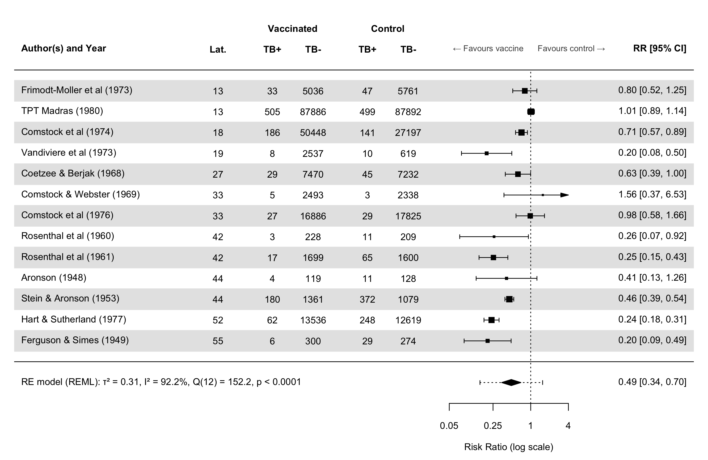

# Meta-Analysis of BCG Vaccine Trials

Random-effects meta-analysis and meta-regression of 13 controlled trials of the BCG vaccine against tuberculosis, written in R with `metafor`. The analysis follows the kind of evidence synthesis used in health technology assessment: pooled effect, heterogeneity, a pre-specified moderator, and checks for publication bias and robustness.



## Key findings

| | Result |
|---|---|
| **Pooled effect** (random effects, REML) | RR **0.49** (95% CI 0.34 to 0.70): about 51% lower TB risk with vaccination |
| **Heterogeneity** | I² = 92.2% (95% CI 81.9 to 97.7), τ² = 0.31; 95% prediction interval 0.15 to 1.55 |
| **Latitude** (meta-regression) | Each 10° further from the equator multiplies the RR by **0.75** (95% CI 0.65 to 0.86); latitude explains **76%** of the heterogeneity |
| **Predicted effect** | Little or no protection near 10° latitude (RR 0.96) rising to about 74% at 55° (RR 0.26) |
| **Robustness** | Latitude effect significant under Knapp-Hartung (p = 0.005) and permutation (p = 0.005) tests, and in all 13 leave-one-out fits |
| **Publication bias** | No evidence of small-study effects (Egger p = 0.42, Begg p = 0.95); trim-and-fill adjusted RR 0.52 (0.37 to 0.74) |

**Bottom line:** BCG is protective on average, but its efficacy varies widely between settings, and absolute latitude explains most of that variation. A single pooled RR would be a misleading summary on its own.

## Analysis

| Step | Script | What it does | Report |
|---|---|---|---|
| 1 | `R/01_data_prep.R` | Log risk ratios with `escalc()`, trial characteristics table | [01_data_prep.md](reports/01_data_prep.md) |
| 2 | `R/02_main_models.R` | Fixed-effect vs random-effects (REML) vs Knapp-Hartung; study weights | [02_main_models.md](reports/02_main_models.md) |
| 3 | `R/03_forest_plot.R` | Forest plot ordered by latitude, with prediction interval | [03_forest_plot.md](reports/03_forest_plot.md) |
| 4 | `R/04_heterogeneity.R` | Q, τ², I², H² with Q-profile CIs; six τ² estimators; Baujat plot | [04_heterogeneity.md](reports/04_heterogeneity.md) |
| 5 | `R/05_meta_regression.R` | Meta-regression on latitude (Wald, Knapp-Hartung, permutation tests); predicted RR by latitude; exploratory moderators | [05_meta_regression.md](reports/05_meta_regression.md) |
| 6 | `R/06_bias_sensitivity.R` | Contour-enhanced funnel plot, Egger and Begg tests, trim-and-fill, leave-one-out, influence diagnostics | [06_bias_sensitivity.md](reports/06_bias_sensitivity.md) |

Each script writes a Markdown report to `reports/`, CSV tables to `outputs/tables/` and figures to `outputs/figures/`.

<p align="center">
  
</p>

## How to run

Requires R (≥ 4.1). Missing packages (`metafor`, `metadat`, `here`, `dplyr`, `readr`, `knitr`) are installed automatically on the first run.

**From the terminal:**

```bash
./run.sh          # run every step in order
./run.sh 05       # run a single step
./run.sh 02 03    # run selected steps
```

**From RStudio:** open `bcg-vaccine-trials.Rproj` and source the scripts in `R/` in numeric order.

## Repository structure

```
├── R/                 # numbered analysis scripts (00_setup.R holds shared settings and report helpers)
├── data/processed/    # derived effect sizes
├── outputs/
│   ├── figures/       # forest, Baujat, bubble and funnel plots
│   └── tables/        # CSV results
├── reports/           # one Markdown report per step
├── run.sh             # terminal runner
└── PROJECT_OUTLINE.md # analysis plan
```

## Limitations

- Only 13 trials, so tests for moderators and small-study effects have limited power.
- Meta-regression is observational at the trial level. Latitude may stand in for other factors (environmental mycobacteria, BCG strain, diagnostic practice), and trial-level associations may not apply to individuals.
- Substantial residual heterogeneity remains after adjusting for latitude (residual I² = 68%).

## Data

`metadat::dat.bcg`, the companion dataset to `metafor`, from:

Colditz GA, Brewer TF, Berkey CS, et al. Efficacy of BCG vaccine in the prevention of tuberculosis: meta-analysis of the published literature. *JAMA*. 1994;271(9):698–702.
