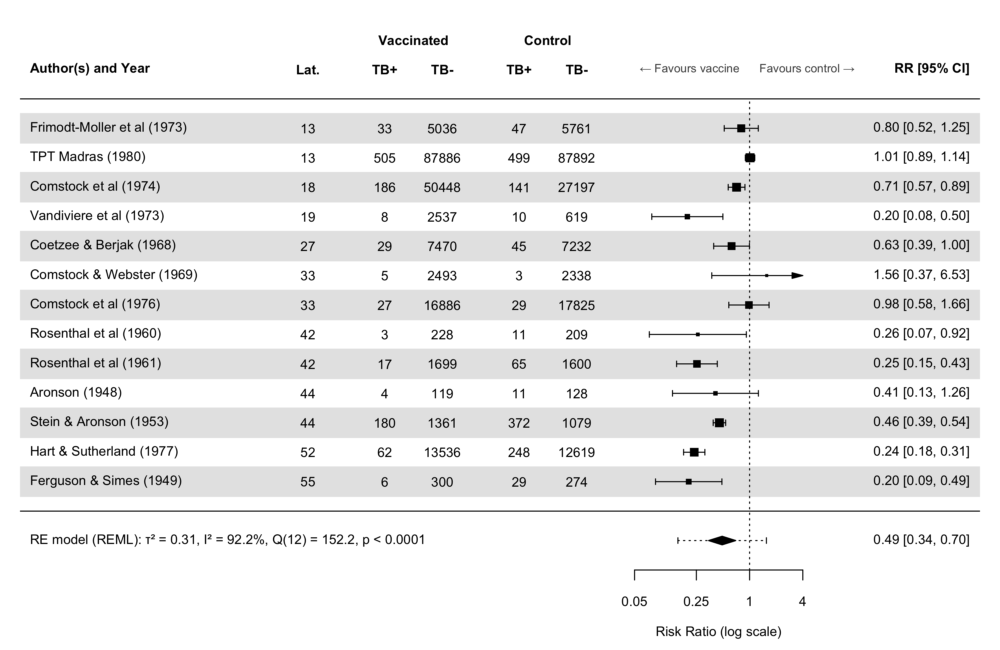

# Step 3: Forest Plot

_Generated by `R/03_forest_plot.R` on 2026-11-20 18:45 (R 4.5.3, metafor 5.2.1)_

_Figure 1. Random-effects meta-analysis of BCG vaccine trials, ordered by absolute latitude._

## How to read it

- Each square is one trial's risk ratio; its size reflects the trial's weight in the random-effects model, and the horizontal line is its 95% CI.
- The diamond is the pooled estimate: RR 0.49, 95% CI 0.34 to 0.70.
- The dotted line through the diamond is the 95% prediction interval (0.15 to 1.55): the range of true effects expected in a new setting.
- `Lat.` is the absolute latitude of the trial site; TB+/TB- are TB cases and non-cases in each arm.

## What it shows

Sorting by latitude makes a pattern visible: protection tends to be weaker in trials nearer the equator. The median trial RR is 0.71 for trials below 30° latitude (5 trials) versus 0.34 for trials at 30° or above (8 trials), although there are exceptions in both groups. Step 5 tests this formally with a meta-regression on latitude.

## Files written

- `outputs/figures/forest_plot.png`

