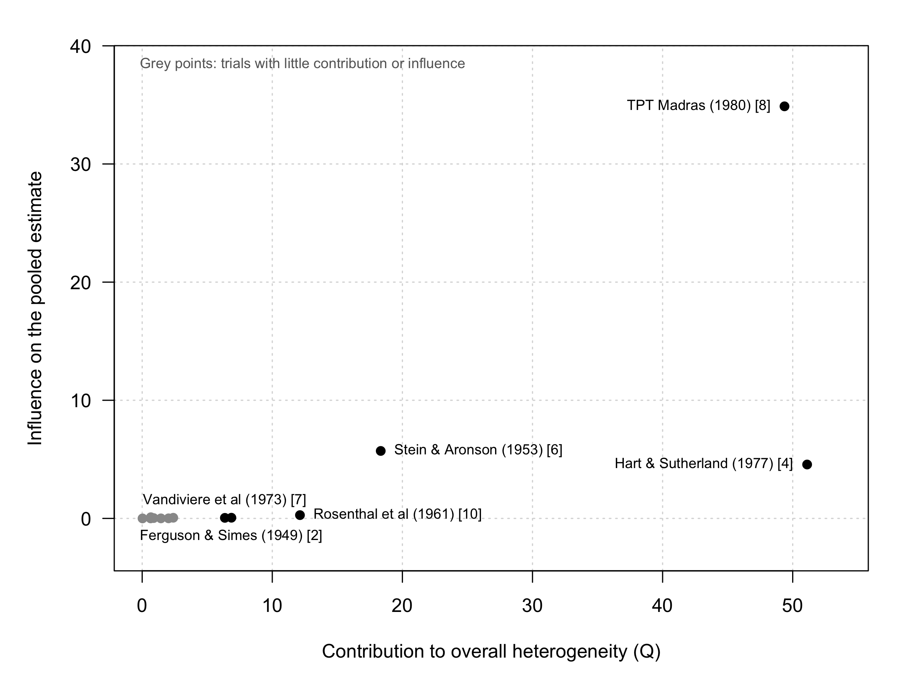

# Step 4: Heterogeneity

_Generated by `R/04_heterogeneity.R` on 2026-11-20 18:45 (R 4.5.3, metafor 5.2.1)_

## Heterogeneity statistics

**Table 4. Heterogeneity statistics (random-effects model, REML; Q-profile 95% CIs)**

|Statistic |Estimate |95% CI           |
|:---------|:--------|:----------------|
|Q         |152.233  |–                |
|τ²        |0.313    |0.120 to 1.111   |
|τ         |0.560    |0.346 to 1.054   |
|I² (%)    |92.221   |81.918 to 97.678 |
|H²        |12.856   |5.530 to 43.068  |

- **Q**: test of whether all trials share one true effect.
- **τ² / τ**: between-trial variance / SD of the true log risk ratios.
- **I²**: share of total variability due to true between-trial differences rather than chance.
- **H²**: ratio of total variability to sampling variability (1 = no heterogeneity).

## Interpretation

Heterogeneity is substantial: Q(12) = 152.2 (p < 0.0001), and an estimated 92.2% of the variability (95% CI 81.9 to 97.7%) reflects real differences between trials rather than sampling error. With τ = 0.56 on the log scale, the true risk ratio in a typical trial setting could plausibly be anywhere from about 0.16 to 1.47. Even the lower end of the I² interval indicates considerable heterogeneity, so a single pooled RR on its own is not an adequate summary.

## Sensitivity to the τ² estimator

**Table 5. τ² and pooled RR under different estimators**

|Estimator                            |τ²    |I² (%) |Pooled RR (95% CI) |
|:------------------------------------|:-----|:------|:------------------|
|DerSimonian-Laird (DL)               |0.309 |92.1   |0.49 (0.34, 0.70)  |
|Restricted maximum likelihood (REML) |0.313 |92.2   |0.49 (0.34, 0.70)  |
|Maximum likelihood (ML)              |0.280 |91.4   |0.49 (0.35, 0.69)  |
|Paule-Mandel (PM)                    |0.318 |92.3   |0.49 (0.34, 0.70)  |
|Sidik-Jonkman (SJ)                   |0.346 |92.9   |0.49 (0.34, 0.70)  |
|Hedges (HE)                          |0.329 |92.6   |0.49 (0.34, 0.70)  |

τ² ranges from 0.28 to 0.35 across estimators, while the pooled RR is 0.49 under every estimator. The conclusion that BCG is protective on average does not depend on the estimator chosen.

## Which trials drive the heterogeneity?

_Figure 2. Baujat plot: each point is a trial (trial number in brackets); trials to the right add most to heterogeneity, trials higher up shift the pooled estimate most._

**Table 6. Contribution of each trial to Cochran's Q (relative to the fixed-effect estimate)**

| Trial|Study                       | Latitude| Q contribution| % of Q|
|-----:|:---------------------------|--------:|--------------:|------:|
|     4|Hart & Sutherland (1977)    |       52|           51.1|   33.6|
|     8|TPT Madras (1980)           |       13|           49.4|   32.4|
|     6|Stein & Aronson (1953)      |       44|           18.3|   12.0|
|    10|Rosenthal et al (1961)      |       42|           12.1|    8.0|
|     2|Ferguson & Simes (1949)     |       55|            6.9|    4.5|
|     7|Vandiviere et al (1973)     |       19|            6.4|    4.2|
|    13|Comstock et al (1976)       |       33|            2.4|    1.6|
|     3|Rosenthal et al (1960)      |       42|            2.0|    1.3|
|    12|Comstock & Webster (1969)   |       33|            1.4|    0.9|
|     5|Frimodt-Moller et al (1973) |       13|            0.9|    0.6|
|    11|Comstock et al (1974)       |       18|            0.7|    0.4|
|     1|Aronson (1948)              |       44|            0.6|    0.4|
|     9|Coetzee & Berjak (1968)     |       27|            0.0|    0.0|

Hart & Sutherland (1977) (latitude 52°) and TPT Madras (1980) (latitude 13°) together account for 66% of Q. Step 5 examines whether latitude explains this pattern.

## Files written

- `outputs/tables/04_heterogeneity.csv`
- `outputs/tables/04_tau2_estimators.csv`
- `outputs/tables/04_q_contributions.csv`
- `outputs/figures/baujat_plot.png`

