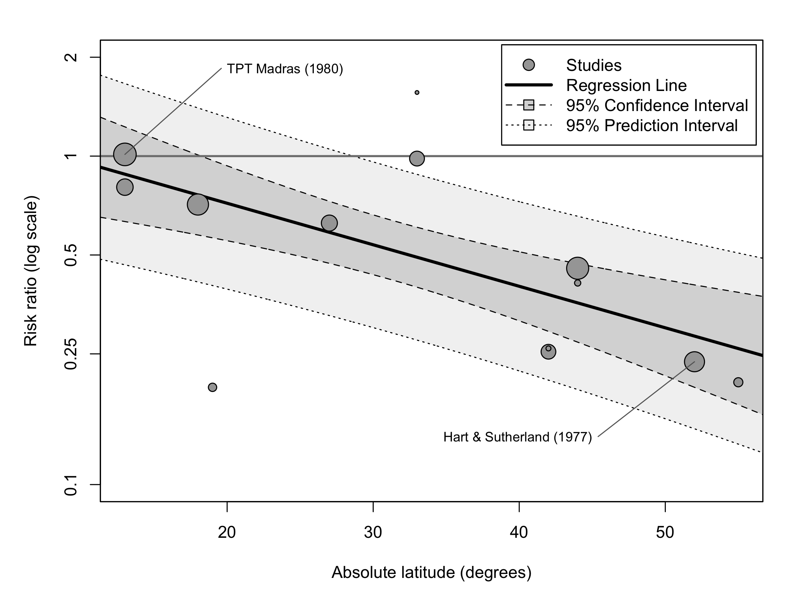

# Step 5: Meta-Regression on Latitude

_Generated by `R/05_meta_regression.R` on 2026-11-20 18:45 (R 4.5.3, metafor 5.2.1)_

## Rationale

Steps 2–4 showed substantial heterogeneity (I² = 92.2%). A long-standing hypothesis is that BCG works less well near the equator, possibly because of greater exposure to environmental mycobacteria, which may provide some natural protection in unvaccinated people. This step tests whether absolute latitude explains the variation in trial results.

## Model

Mixed-effects meta-regression, log RR = β₀ + β₁ × latitude, fitted by REML. Because there are only 13 trials, the latitude effect is also tested with the Knapp-Hartung adjustment and a permutation test (5,000 permutations), which do not rely on large-sample approximations.

## Results

**Table 7. Meta-regression coefficients (log risk ratio scale)**

|Term                  |Estimate (log RR) |95% CI             |p (Wald z) |p (Knapp-Hartung) |p (permutation) |
|:---------------------|:-----------------|:------------------|:----------|:-----------------|:---------------|
|Intercept             |0.2515            |-0.2368 to 0.7397  |0.3127     |0.3948            |0.7050          |
|Latitude (per degree) |-0.0291           |-0.0432 to -0.0150 |< 0.0001   |0.0046            |0.0050          |

Each additional 10 degrees of latitude multiplies the risk ratio by **0.75** (95% CI 0.65 to 0.86), meaning greater protection further from the equator. Latitude explains an estimated **76%** of the between-trial heterogeneity (τ² falls from 0.313 to 0.076). The association holds under the Knapp-Hartung test (p = 0.0046) and the permutation test (p = 0.0050).

_Figure 3. Bubble plot: observed risk ratios by latitude (bubble size proportional to weight), with the fitted regression line, 95% CI and 95% prediction interval._

## Predicted effect by latitude

**Table 8. Predicted risk ratio of TB at selected latitudes**

| Latitude (°)|Predicted RR (95% CI) |95% PI       |Estimated risk reduction |
|------------:|:---------------------|:------------|:------------------------|
|           10|0.96 (0.67, 1.39)     |0.50 to 1.85 |4%                       |
|           20|0.72 (0.55, 0.93)     |0.39 to 1.31 |28%                      |
|           30|0.54 (0.44, 0.66)     |0.30 to 0.96 |46%                      |
|           40|0.40 (0.32, 0.51)     |0.22 to 0.73 |60%                      |
|           50|0.30 (0.21, 0.42)     |0.16 to 0.57 |70%                      |
|           55|0.26 (0.17, 0.38)     |0.13 to 0.51 |74%                      |

Extrapolating the fitted line, the predicted RR would reach 1 at about 9° latitude, below the lowest trial latitude (13°), so this should be read cautiously.

## Exploratory moderators

**Table 9. Comparison of candidate moderators**

|Moderators                  |QM (df)   |p (QM)   |Residual τ² |Residual I² (%) |R² (%) |p (residual heterogeneity) |
|:---------------------------|:---------|:--------|:-----------|:---------------|:------|:--------------------------|
|Latitude                    |16.36 (1) |< 0.0001 |0.076       |68.4            |75.6   |0.0012                     |
|Publication year            |2.69 (1)  |0.1012   |0.267       |87.7            |14.9   |< 0.0001                   |
|Allocation method           |1.77 (2)  |0.4132   |0.362       |88.8            |0.0    |< 0.0001                   |
|Latitude + publication year |12.20 (2) |0.0022   |0.111       |72.0            |64.6   |0.0016                     |

These comparisons are exploratory: with 13 trials there is little power, and moderators such as publication year and latitude are correlated (r = -0.66), so their effects are hard to separate. Latitude was the pre-specified moderator and remains the primary analysis.

## Caveats

- Meta-regression is observational at the trial level: latitude may stand in for other factors (e.g. environmental mycobacteria, BCG strain, diagnostic practices) and does not prove a causal mechanism.
- Associations across trials do not necessarily apply to individuals within trials (ecological bias).
- Residual heterogeneity remains (see the residual τ² and p-value in Table 9).

## Files written

- `outputs/tables/05_meta_regression_coefficients.csv`
- `outputs/tables/05_predicted_rr_by_latitude.csv`
- `outputs/tables/05_moderator_comparison.csv`
- `outputs/figures/bubble_plot_latitude.png`

