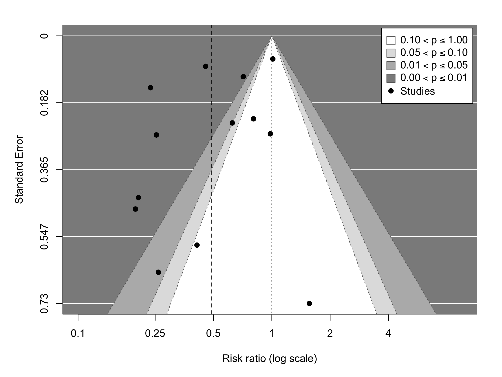

# Step 6: Publication Bias and Sensitivity Analyses

_Generated by `R/06_bias_sensitivity.R` on 2026-11-20 18:45 (R 4.5.3, metafor 5.2.1)_

## Funnel plot

_Figure 4. Contour-enhanced funnel plot. Shaded regions mark where a trial's result would be statistically significant (p < 0.10, 0.05, 0.01); the dashed line is the pooled random-effects estimate._

If small trials with null results had gone unpublished, the funnel would show a gap in the white (non-significant) region near the bottom. Contour shading helps separate this from asymmetry caused by other factors.

## Tests for funnel plot asymmetry

**Table 10. Tests for small-study effects**

|Test                                           |Statistic          |p-value |
|:----------------------------------------------|:------------------|:-------|
|Egger's regression test                        |z = -0.80          |0.4218  |
|Egger's regression test, adjusted for latitude |z = -0.60          |0.5492  |
|Begg & Mazumdar rank correlation               |Kendall's τ = 0.03 |0.9524  |

Egger's test shows no clear evidence of asymmetry (p = 0.422). After adjusting for latitude, the p-value is 0.549. With only 13 trials and substantial heterogeneity, these tests have low power, and any asymmetry can reflect true differences between trials (for example, latitude) rather than publication bias.

## Trim-and-fill

**Table 11. Trim-and-fill sensitivity analysis**

|Analysis                         | Trials (k)|Pooled RR (95% CI) |
|:--------------------------------|----------:|:------------------|
|Random-effects (observed trials) |         13|0.49 (0.34, 0.70)  |
|Trim-and-fill adjusted           |         14|0.52 (0.37, 0.74)  |

Trim-and-fill imputed 1 potentially missing trial on the right (favouring control) side, giving an adjusted RR of 0.52 (0.37, 0.74). Trim-and-fill assumes asymmetry is caused by publication bias, which is doubtful here given the heterogeneity explained by latitude, so it is reported as a sensitivity analysis only.

## Leave-one-out and influence

**Table 12. Results with each trial omitted in turn, and influence diagnostics for the random-effects model**

|Trial omitted               |Pooled RR (95% CI) |I² (%) |RR per 10° latitude |p (latitude) |Studentised residual |Cook's D |Influential |
|:---------------------------|:------------------|:------|:-------------------|:------------|:--------------------|:--------|:-----------|
|Aronson (1948)              |0.49 (0.34, 0.72)  |93.2   |0.75                |0.0001       |-0.22                |0.00     |            |
|Ferguson & Simes (1949)     |0.52 (0.36, 0.74)  |92.3   |0.76                |0.0007       |-1.29                |0.11     |            |
|Rosenthal et al (1960)      |0.50 (0.35, 0.73)  |92.9   |0.75                |0.0001       |-0.75                |0.03     |            |
|Hart & Sutherland (1977)    |0.53 (0.38, 0.75)  |90.4   |0.77                |0.0032       |-1.45                |0.23     |            |
|Frimodt-Moller et al (1973) |0.47 (0.32, 0.68)  |92.8   |0.74                |0.0007       |0.85                 |0.08     |            |
|Stein & Aronson (1953)      |0.49 (0.33, 0.73)  |90.9   |0.73                |< 0.0001     |-0.12                |0.00     |            |
|Vandiviere et al (1973)     |0.52 (0.36, 0.74)  |92.3   |0.73                |< 0.0001     |-1.30                |0.11     |            |
|TPT Madras (1980)           |0.45 (0.32, 0.64)  |87.0   |0.77                |0.0047       |1.45                 |0.20     |            |
|Coetzee & Berjak (1968)     |0.48 (0.32, 0.70)  |93.2   |0.75                |0.0004       |0.41                 |0.02     |            |
|Rosenthal et al (1961)      |0.52 (0.36, 0.75)  |92.2   |0.76                |0.0001       |-1.13                |0.12     |            |
|Comstock et al (1974)       |0.47 (0.32, 0.69)  |91.8   |0.75                |0.0009       |0.67                 |0.06     |            |
|Comstock & Webster (1969)   |0.47 (0.33, 0.67)  |92.7   |0.75                |< 0.0001     |1.29                 |0.06     |            |
|Comstock et al (1976)       |0.46 (0.32, 0.66)  |92.3   |0.74                |< 0.0001     |1.19                 |0.12     |            |

Omitting any single trial gives a pooled RR between 0.45 and 0.53, and the upper CI limit stays below 1 in 13 of 13 cases. The latitude effect is also stable: the RR per 10° ranges from 0.73 to 0.77, with p < 0.05 in 13 of 13 leave-one-out fits. No trial meets metafor's criteria for being influential.

## Conclusion

The main findings (a protective average effect of BCG, and stronger protection at higher latitudes) do not depend on any single trial. There is no clear evidence of small-study effects, although with 13 trials these tests can only detect strong asymmetry.

## Files written

- `outputs/figures/funnel_plot.png`
- `outputs/tables/06_asymmetry_tests.csv`
- `outputs/tables/06_trim_and_fill.csv`
- `outputs/tables/06_leave_one_out.csv`
- `outputs/tables/06_influence.csv`
- `outputs/tables/06_leave_one_out_latitude.csv`

